# 🛡️ Awesome Enterprise Risk Management (ERM)

**A curated index of top-tier Enterprise Risk Management (ERM) SaaS platforms and self-hosted open-source GRC software.**  
*Covering Risk Registers, Internal Controls Mapping, Audit Management, Regulatory Compliance, and AI Risk Governance.*

📅 **Last updated: March 2026**

---

## 📑 Table of Contents
- [📌 Overview & SEO Summary](#-overview--seo-summary)
- [📈 Sector Overview & Market Dynamics](#-sector-overview--market-dynamics)
- [☁️ SaaS / Hosted ERM Platforms](#️-saas--hosted-erm-platforms)
- [💻 Open-Source GitHub Projects](#-open-source-github-projects)
- [🤝 How to Contribute](#-how-to-contribute)
- [⭐ Star History](#star-history)
- [💖 Support & Sponsorship](#-support--sponsorship)
- [⚠️ Disclaimer](#️-disclaimer)

---

## 📌 Overview & SEO Summary

**Enterprise Risk Management (ERM)** is the structured, organization-wide framework used by boards, chief risk officers (CROs), and compliance leaders to identify, evaluate, monitor, and treat strategic, operational, financial, and cybersecurity risks. 

Modern ERM tooling bridges executive heat maps and board reporting with operational governance, risk, and compliance (**GRC**) workflows—such as control mapping against standards like **ISO 27001**, **SOC 2**, **NIST CSF 2.0**, **COSO ERM**, **HIPAA**, and the **EU AI Act**.

Whether you are evaluating market-leading multi-tenant SaaS solutions or seeking self-hosted, Docker-deployable open-source frameworks for complete data sovereignty, this repository provides verified pricing benchmarks, corporate scales, and community-audited repositories.

---

## 📈 Sector Overview & Market Dynamics

The global **Enterprise Risk Management (ERM)** software market is valued at approximately **$6.0B to $7.0B**, expanding to over **$20B–$40B** across the integrated Governance, Risk, and Compliance (eGRC) software and services sector, compounding at a **~14.8% CAGR** through the early 2030s. Growth is propelled by escalating cyber perils, supply chain disruptions, strict regulatory mandates (e.g., EU DORA, NIS2, SEC cyber disclosure rules), and emergent AI governance standards (ISO 42001, NIST AI RMF).

The industry exhibits **high fragmentation** rather than a winner-take-all monopoly:
* **Enterprise Heavyweights (ServiceNow, Diligent, RSA Archer, MetricStream)** anchor complex Fortune 500 deployments requiring deep ERP integrations and multi-subsidiary governance.
* **Mid-Market Challengers (AuditBoard, Riskonnect, LogicManager)** capture organizations seeking accelerated implementation, modern user experiences, and transparent total-cost-of-ownership (TCO).
* **Open-Source & Self-Hosted Platforms (CISO Assistant, Probo, Comply, SimpleRisk)** serve engineering-led security teams and privacy-conscious enterprises prioritizing on-premise data control, zero seat-tax, and programmable API / MCP integrations.

---

## ☁️ SaaS / Hosted ERM Platforms

*The table below compares leading commercial ERM & GRC platforms, **sorted in descending order by company scale** (Market Capitalization / Enterprise Valuation / Annual Recurring Revenue).*

| 🏢 Product | 💼 Company Scale (Valuation / Revenue) | 📝 Description | 💵 Pricing (Starting Tier) | 🎁 Free Tier / Free Trial Limits |
|:---|:---|:---|:---|:---|
| **[ServiceNow GRC (IRM)](https://www.servicenow.com/)** | **~$107B–$160B+ Market Cap** ($15.4B TTM Revenue) | Enterprise Integrated Risk Management (IRM) unified with IT workflows, continuous control automation, and real-time operational resilience. | **$125 / operator / month** (IRM Standard tier; Enterprise tier at $375/op/mo; Lite operators ~$75/mo for attestations) | **No public free tier or free trial** (POC instances available via sales consultation) |
| **[Diligent HighBond](https://www.diligent.com/)** | **~$4B–$7B Enterprise Valuation** (~$325M+ Revenue) | Modern governance, risk, and audit management platform covering ERM, third-party vendor risk, and board-level reporting. | **$23,488 / year** (Median buyer contract based on 4 procurement benchmarks; sales quote required) | **14-day free trial** for select add-ons (GovernAI module); no free forever plan |
| **[AuditBoard](https://www.auditboard.com/)** | **$3.0B+ Valuation** ($200M+ ARR, acquired by Hg) | Premier connected risk, internal audit, SOX controls compliance, and operational risk management platform. | **$45,947 / year** (Median annual contract per Vendr procurement benchmarks) | **No public free tier or free trial** (Custom interactive demo available upon request) |
| **[RSA Archer](https://www.archerirm.com/)** | **Major Enterprise Scale** ($150M+ ARR, backed by Cinven) | Legacy enterprise GRC fixture across regulated financial, banking, and public sectors with 7 dedicated risk solution modules. | **$671.31 / month per user** (CDW-G published 1-month commercial subscription rate) | **No public free tier or free trial** (Live guided demo via enterprise sales) |
| **[Riskonnect](https://www.riskonnect.com/)** | **~$135M+ Revenue / ~$1B Valuation** (TA Associates / Thoma Bravo) | Comprehensive Integrated Risk Management platform covering ERM, claims administration, business continuity, and project risk. | **$20,000 one-time / starting** (Software Advice verified entry benchmark) | **No public free tier or free trial** (Custom guided proof-of-concept arranged via sales) |
| **[MetricStream](https://www.metricstream.com/)** | **~$478M Valuation** (~$150M–$250M Est. Revenue) | Scalable enterprise GRC platform delivering connected risk, operational resilience, and automated compliance frameworks. | **$75,000 / year** (SelectHub starting entry benchmark for enterprise deployments) | **No public free tier or free trial** (Custom proof-of-concept sandbox demo upon request) |
| **[Resolver](https://www.resolver.com/)** | **~$50M–$80M Revenue** (Acquired by Kroll) | Cloud-based risk intelligence and ERM software mapping regulatory obligations, internal controls, and incident management. | **$10,000 / year** (Software Advice verified starting entry tier; typical contracts $30K–$65K/yr) | **No public free tier or free trial** (Tailored product walkthrough available via sales) |
| **[LogicManager](https://www.logicmanager.com/)** | **~$6M–$8M ARR** (Bootstrapped & Profitable) | All-inclusive ERM software featuring taxonomy-based risk assessments, incident management, and unlimited user models. | **$10,000 / year** (Software Advice listing; includes advisory onboarding and unlimited users) | **90-day unconditional money-back guarantee**; no self-serve free tier or free trial |

---

## 💻 Open-Source GitHub Projects

*The table below catalogs premier open-source ERM, self-hosted GRC platforms, and quantitative risk engines, **sorted in descending order by GitHub_Stars**.*

| 🚀 Project | ⭐ Stars_Count & Stargazers Link | 🛠️ Architecture & Focus | 📋 Key Capabilities |
|:---|:---:|:---|:---|
| **[CISO Assistant](https://github.com/intuitem/ciso-assistant-community)** |  | Python / Django / React (Docker self-hostable) | **One-stop-shop modern GRC platform** supporting 200+ global frameworks (ISO 27001, NIST CSF 2.0, SOC 2, NIS2, DORA, GDPR). Reusable risk registers, automatic control mapping, API/n8n/MCP integrations, and built-in privacy impact assessments. |
| **[Comply](https://github.com/strongdm/comply)** |  | Go / CLI / Markdown GitOps | **SOC 2 and compliance automation framework as code.** Generates audit-ready policies, orchestrates ticketing-based compliance workflows, maintains procedure registers, and embeds policy governance directly in Git repositories. |
| **[Probo](https://github.com/getprobo/probo)** |  | Go / PostgreSQL / React (ISC License) | **Full-lifecycle modern open-source GRC suite.** Features risk registers with customizable scoring/treatment, vendor risk management, data privacy (DPIA/TIA), access reviews, document signing, and **270+ MCP tools** for autonomous AI agent integration. |
| **[Gapps](https://github.com/bmarsh9/gapps)** |  | Python / Flask / SQLite / Docker | **Multi-framework security compliance & risk tracking platform.** Maps controls across SOC 2, ISO 27001, NIST 800-53, NIST CSF, HIPAA, CMMC, CSC CIS 18, and PCI DSS with audit evidence tracking. |
| **[riskquant](https://github.com/Netflix-Skunkworks/riskquant)** |  | Python / Jupyter / Statistical Modeling | **Quantitative risk analysis engine by Netflix.** Implements the FAIR (Factor Analysis of Information Risk) framework to quantify annualized loss expectancies (ALE) and generate loss exceedance curves for enterprise decision-making. |
| **[Deming](https://github.com/sourcentis/deming)** |  | PHP / Symfony / MySQL | **Information Security Management System (ISMS) & GRC manager.** Structured around PDCA (Plan-Do-Check-Act) cycles for ISO 27001, handling risk treatment plans, asset inventories, continuous audit tracking, and security incident management. |
| **[OpenGRC](https://github.com/LeeMangold/OpenGRC)** |  | PHP / Laravel / MySQL | **Lightweight self-hosted GRC platform built for small-to-mid security teams.** Covers enterprise risk registers, control crosswalks, vendor risk evaluations, and incident response tracking for ISO 27001, SOC 2, and HIPAA. |
| **[SimpleRisk](https://github.com/simplerisk/code)** |  | PHP / MySQL / Docker | **The pioneer in simplified open-source Enterprise Risk Management.** Features an out-of-the-box dynamic risk register, risk mitigation workflows, Secure Controls Framework (SCF) crosswalks, and Docker one-command local/cloud deployment. |
| **[Eramba](https://github.com/eramba/docker)** |  | PHP / Docker / MySQL | **Heavyweight multi-framework GRC & evidence management system.** Designed for cross-framework control mapping, automated audit reminder cadences, enterprise risk scoring, and policy lifecycle workflows. |
| **[OpenRisk](https://github.com/opendefender/OpenRisk)** |  | Python / React / AGPLv3 | **Unified threat intelligence and risk management platform.** Features complete risk register lifecycle tracking, asset inventory scoring, vulnerability management, and FAIR-aligned quantitative evaluations. |
| **[GRCbit](https://github.com/grcbit/grc)** |  | Python / Web2py | **Open-source IT risk management & compliance tool.** Automates control audits, tracks vulnerability remediation workflows, and aligns infrastructure against standard regulatory checklists. |

---

## 🤝 How to Contribute

Contributions from risk professionals, GRC engineers, and developers are warmly welcomed! 

1. 🍴 **Fork the repository** to your personal GitHub account.
2. 🌿 **Create a new branch** (`git checkout -b feature/add-new-erm-tool`).
3. 📝 **Add your tool** following the existing tabular format:
   - For **SaaS**: Include accurate pricing starting tiers, specific trial limits, and company scale metrics.
   - For **Open-Source**: Provide the GitHub repo URL, active Stars_Count badge linking to `/stargazers`, stack details, and key ERM features.
4. 🧪 **Check link validity & markdown formatting**.
5. 🚀 **Submit a Pull Request** with a brief summary explaining the tool's core functionality.

---

##  Star History

---

## 💖 Support & Sponsorship

Thank you so much for exploring this Enterprise Risk Management curated directory! If you found this resource helpful, please consider supporting the project:

- ⭐ **Star this repository** to help others in the security, risk, and compliance community discover it.
- 🍴 **Fork and share** with colleagues, GRC engineers, and risk officers.
- ☕ **Buy a coffee & sponsor**: If this project saved you or your team time, consider backing continuous updates via the [GitHub Sponsors Dashboard](https://github.com/sponsors/ishandutta2007).

---

## ⚠️ Disclaimer

- This repository is a **community-curated, independent directory** for educational and informational purposes; it does not constitute financial, legal, or audit advisory.
- Enterprise risk data and audit logs are sensitive assets—ensure your self-hosted or SaaS deployments adhere to local regulatory boundaries, TLS encryption, and least-privilege RBAC.
- **Enterprise Software Pricing Notice**: Enterprise software pricing evolves continuously. While figures reflect verified buyer benchmarks (Vendr, SelectHub, Software Advice, CDW-G) and company reports, always verify directly with vendors for contractual quotes.
